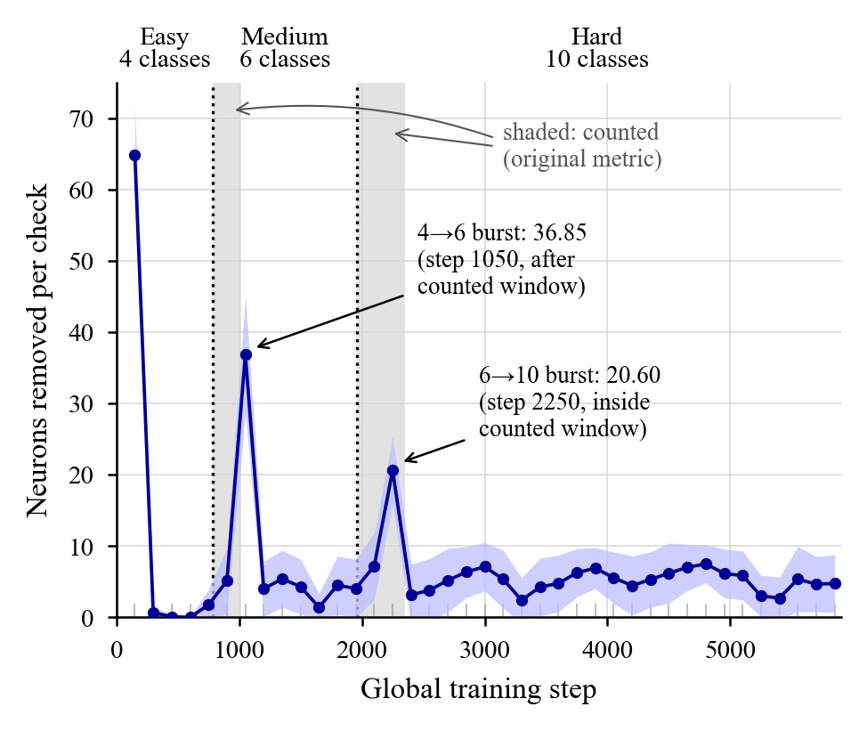

# Metabolic Neural Networks

**One local signal, three structural decisions: how neurons can grow, prune, and protect themselves without being told to.**

This repository contains the implementation and experimental results for a project testing whether a single local statistic, a neuron's rolling activation rate, can drive structural decisions during neural network training (removing unused neurons, growing overloaded ones, and protecting important ones) with no global supervision, fixed schedules, or external task labels.

## The idea

Each neuron in the metabolic layer tracks one private number, `r(i)`: the fraction of samples on which its pre-activation was positive, averaged over the last 150 training steps. Every 150 steps, three fixed thresholds turn this number into structural decisions:

| Decision | Condition | Effect |
|---|---|---|
| **Death** | `r(i) < 0.05` | Neuron is removed (never below `N_min = 16` alive) |
| **Birth** | `r(i) > 0.70` during a loss plateau | Neuron is duplicated, with noise |
| **Consolidation** | `r(i) > 0.30` after a burst of 5+ deaths in one check | Neuron is frozen against further updates |

No part of this mechanism is told when a task changes or how hard it is. All decisions are inferred purely from each neuron's own local activation history. Under ReLU, the death rule is exact in the limiting case: a neuron with `r(i) = 0` contributed exactly zero gradient over its window, so removing it changes nothing already computed.

## What's in this repo

- `Experiment1.ipynb`: Kaggle notebook implementing the `MetabolicLayer` and Experiment 1, *Shift Detection via Reorganization Bursts*, with its saved output.
- `Experiment2.ipynb`: the Experiment 2 (continual learning) code. Despite the extension, the file is plain Python source rather than notebook JSON. Paste it into a notebook cell or save it as `.py` to run it.
- [`reproduction/`](reproduction/): an exact reproduction of Experiment 1, the confound controls, SVHN, a binary-rate variant and a Fisher-vs-rate analysis. Includes all scripts, raw per-seed / per-check logs and figures. See [`reproduction/REPORT.md`](reproduction/REPORT.md).

## Experiment 1: Does the network notice when tasks get harder?

A 3-phase CIFAR-10 curriculum (4 classes, then 6, then all 10) was run with no signal given to the network about phase transitions. The original metric counts neuron deaths in the first epoch after each transition, over two independent batches of 10 seeds.

| Batch | Easy→Medium deaths | Medium→Hard deaths | Ratio | p-value | Cohen's d |
|---|---|---|---|---|---|
| 1 (seeds 42, 7, 123, 0, 99, 11, 22, 33, 44, 55) | 6.0 ± 4.2 | 26.8 ± 7.1 | 4.47× | 0.0001 | 2.10 |
| 2 (seeds 100–109) | 4.2 ± 4.7 | 28.8 ± 7.8 | 6.86× | 0.0001 | 2.17 |
| **Pooled (n=20)** | **5.1 ± 4.6** | **27.8 ± 7.5** | **5.45×** | **<0.0001** | **2.15** |

(± is the population SD over seeds. The pooled SDs here are over all 20 seeds; an earlier version of this README averaged the two batch SDs, giving 4.4 and 7.4.)

**This result reproduces exactly but does not measure shift severity.** An independent reproduction got identical per-seed counts for all 20 seeds. Instrumenting the run then showed that most of the 5.45× comes from the counting window:

- **Bursts arrive late.** Reorganisation runs every 150 global steps, and a neuron is only removed once its 150-step rate window is mostly post-shift. Each transition's burst therefore arrives at the *second* check after it.
- **Only one burst is counted.** The 4→6 burst (step 1050, about 37 deaths) falls just after the counted first epoch, which ends at step 1020. The 6→10 burst (step 2250, about 21 deaths) falls inside the counted epoch, which ends at step 2351.
- **Timing alone gives 2.49×.** A timing-matched run with **no distribution shift** gives 2.49× on the same metric.
- **Equal windows remove or reverse the effect.** With equal windows after each transition the ratio is 1.41× (first 150 steps, p=0.24) or **0.66×** (first 300 steps, reversed in 18/20 seeds). With equal epoch lengths it is 0.80× (p=0.28).
- **SVHN reverses it.** With the same code and seeds the original metric reverses (0.50×, p=2e-7), because there both bursts fall inside the counted epochs.

What does hold up:
- Class-adding shifts trigger death bursts above a no-shift baseline.
- Normalised by the live population, the 6→10 shift silences a modestly larger share of surviving neurons (1.16× [1.08, 1.23], p=5e-4, 16/20 seeds).
- Removing classes produces no burst.

Full tables, controls and raw logs: [`reproduction/REPORT.md`](reproduction/REPORT.md).



## Experiment 2: Does protecting memory reduce catastrophic forgetting?

A second experiment compared a static baseline, Elastic Weight Consolidation (EWC), and the metabolic mechanism with and without a consolidation/protection step on Split-CIFAR-10 continual learning. The code is in `Experiment2.ipynb`. The results below are as originally reported; they have **not** been re-run in `reproduction/`.

| Method | Final accuracy | Forgetting |
|---|---|---|
| Static baseline | 76.25% | 16.83% |
| EWC | 83.13% | 7.07% |
| Metabolic, no protection | 74.59% | 18.89% |
| Metabolic, with protection | 76.16% | 16.13% |

Unprotected structural plasticity increased forgetting relative to the static baseline. Adding the protection step recovered most of that gap, though the improvement did not reach statistical significance at the sample sizes tested (p = 0.27–0.37 across runs).

The protection step relies on activation rate as a proxy for importance. In the reproduction, the Spearman correlation between a neuron's rate and its diagonal Fisher importance was ρ = 0.27 ± 0.21 over 10 seeds (positive in 9/10, p=0.0025): a real but weak relationship.

## Usage

**Original notebook.** In a fresh notebook cell, paste the code cell of `Experiment1.ipynb`, then:

```python
run("smoke")                                              # 30s sanity check
run("exp1", seeds=[42,7,123,0,99,11,22,33,44,55], batch_name="batch1")
run("exp1", seeds=[100,101,102,103,104,105,106,107,108,109], batch_name="batch2")
run("meta")                                                # combine both batches
run("figures")                                             # save result PNGs
run("summary")                                             # paper-ready table
```

All experiments use deterministic GPU settings (`cudnn.deterministic=True`, `benchmark=False`). Same-seed results were reproduced exactly on a Kaggle Tesla T4; other GPUs or drivers may differ at the seed level.

**Reproduction and controls.** See [`reproduction/README.md`](reproduction/README.md). It covers the scripted reproduction, the instrumented runs with per-check logging, the control curricula, SVHN, the binary-rate variant and the Fisher analysis. It also shows how to regenerate every table and figure from the saved logs.

## Status

- **Experiment 1:** reproduced exactly from this code (20/20 seeds), with confound controls, SVHN and a binary-rate variant. The original shift-severity interpretation does not survive the controls (see above).
- **Experiment 2:** code included; a fresh reproducible run is not yet done.

## Citation

If you use this work, please cite the accompanying research report: *One Local Signal, Three Structural Decisions: How Neurons Can Grow, Prune, and Protect Themselves Without Being Told To*, Dhiman & Makhambetaliyeva, 2026.
