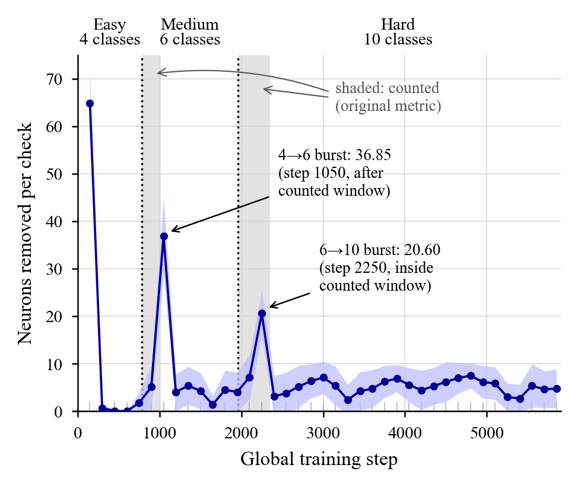

# Reproduction and controls for Experiment 1

This folder reproduces `Experiment1.ipynb` exactly and tests whether its headline result (a 5.45× larger burst of neuron deaths after the harder curriculum transition) survives controls. Full write-up: [REPORT.md](REPORT.md).

## Summary

| Question | Result |
|---|---|
| Does the notebook reproduce? | **Exactly.** All 20 seeds give identical death counts and every aggregate matches (t=9.633, d=2.154, 5.45× [3.64, 9.25], Stouffer z=5.565) on a Kaggle Tesla T4. |
| Is the 5.45× a measure of shift severity? | **Mostly not.** Reorganisation runs every 150 steps, and a burst only appears once the 150-step rate window is post-shift. The 4→6 burst (step 1050) falls just *outside* the counted first epoch; the 6→10 burst (step 2250) falls inside it. |
| What happens with no shift at all, but the same timing? | 2.49× on the same metric (p=2.5e-4). |
| What happens with equal-opportunity windows? | 1.41× (first 150 steps, p=0.24); **0.66×** (first 300 steps, p=7e-4, reversed in 18/20 seeds). Equal-length epochs: 0.80× (p=0.28). |
| What survives? | Class-adding shifts do cause bursts above a no-shift baseline. Normalised by the live population, the 6→10 shift silences a slightly larger share (1.16× [1.08, 1.23], p=5e-4, 16/20 seeds). Removing classes causes no burst. |
| SVHN, same code and seeds? | The original metric **reverses**: 0.50× [0.40, 0.61], p=2e-7, 19/20 seeds. Here both bursts fall inside the counted epochs. Normalised by live population, the transitions are equal (1.00×). |
| Binary per-pass rate (as in the paper's definition)? | Same qualitative results (5.71× on the original metric, 0.68× over the first 300 steps). |
| Fisher importance vs activation rate? | Spearman ρ = 0.27 ± 0.21 over 10 seeds, positive in 9/10 (p=0.0025): a weak proxy. |



## Layout

```
scripts/
  metnn_exp1.py           notebook code cell, verbatim (unchanged logic, seeds, AMP, deterministic cuDNN)
  metnn_instr.py          instrumented copy of _run_curriculum (read-only logging, no extra RNG draws),
                          control curricula (noshift_matched, equal_len, reversed), binary rate
  run_all.py              driver: smoke | part1 | part2 | part3 | svhn
  fisher_vs_rate.py       Fisher importance vs activation rate
  analyze.py              statistics for Parts 1-3  -> results/analysis.md
  analyze_svhn_fisher.py  statistics for SVHN/Fisher -> results/svhn_analysis.md, fisher_analysis.md
  make_figures.py         figures/deaths_per_check_timeline, alive_vs_step, perseed_scatter (PDF+PNG)
  build_kernels.py        packages the scripts into self-contained Kaggle GPU kernels
results/                  raw logs (per-seed, per-check, per-epoch CSV), stdout, environment, tables
figures/                  all figures
```

## Re-running

Requirements: Python 3.10+, the packages in `requirements.txt`, and a CUDA GPU for training. CPU works but is too slow for 20 seeds. All commands run from this folder.

**Training.** Each full run takes about 30 s on a T4.

```bash
cd scripts
python run_all.py smoke --out ../results     # sanity check + original-vs-instrumented match on seed 42
python run_all.py part1 --out ../results     # faithful reproduction, 20 seeds
python run_all.py part2 --out ../results     # instrumented original + 3 control curricula, 80 runs
python run_all.py part3 --out ../results     # binary activation rate, 10 seeds
python run_all.py svhn  --out ../results     # SVHN: unchanged code + instrumented, 40 runs
python fisher_vs_rate.py --out ../results    # Fisher vs rate, 10 seeds (first phase only)
```

**On Kaggle (how these results were produced).** This builds self-contained kernels under `kaggle/` and pushes them with the Kaggle CLI. Set `KAGGLE_USERNAME` to your account first.

```bash
python scripts/build_kernels.py metnn-repro-all metnn-svhn-fisher
kaggle kernels push -p kaggle/metnn-repro-all
```

**Analysis and figures (CPU, seconds).** These regenerate every table and figure from `results/`.

```bash
python scripts/analyze.py results
python scripts/analyze_svhn_fisher.py results
python scripts/make_figures.py results figures
```

## Notes

- **Determinism.** Seed-level agreement was exact on a Kaggle Tesla T4 (driver 580.178, PyTorch 2.11.0+cu128, cuDNN 9.19, Python 3.13.15). Other GPUs or drivers may differ at the seed level.
- **Statistics conventions.** SDs are population SDs (ddof=0), as in the original code. Cohen's d = mean paired difference / SD of differences (ddof=1). Ratio CIs use 10,000 paired bootstrap resamples with a fixed seed, so they depend on seed order.
- **Control curricula RNG.** Subsets and resamples come from a private generator (`10000*seed + phase`), so the global RNG stream matches the original runs.
- **Data downloads.** CIFAR-10 and SVHN are downloaded by torchvision into `./data` on first use.
