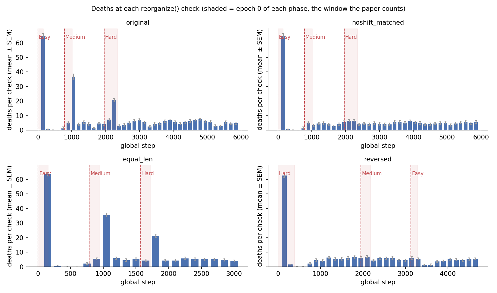

# MetNN Experiment 1: reproduction and confound check

Repo: https://github.com/arnavd371/MetabolicNeuralNetworks (commit `72809f2`), `Experiment1.ipynb`.
Run on Kaggle (Tesla T4), 2026-10-11, with the scripts in `scripts/`. Parts 1–3: 110 CIFAR-10 training runs. Parts 4–5 (SVHN, Fisher vs rate): 40 SVHN training runs plus 10 first-phase runs. All runs are reported; none were excluded.

## Verdict (CIFAR-10)

**The reproduction is exact. The headline 5.45× effect does not survive the equal-opportunity and no-shift controls.**

- Most of the 5.45× comes from where the counting window ends, not from shift severity. A neuron can only be removed once its 150-step rate window lies mostly after the shift. Each transition's death burst therefore lands at the **second** `reorganize()` check after it: steps 1050 and 2250.
  - Medium epoch 0 is 235 steps long and ends at step 1020, so the 4→6 burst (36.9 deaths on average) falls just outside the counted window.
  - Hard epoch 0 is 391 steps long and ends at step 2351, so the 6→10 burst (20.6 deaths) falls inside it.
- Medium's epoch-0 count does not measure the shift at all. A run with identical timing but **no class change** gives the same Medium epoch-0 deaths in 17/20 seeds (5.15 vs 5.10).
- With equal counting windows, the effect disappears (150 steps: 1.41×, p=0.24) or reverses (300 steps: 0.66×, p=7e-4, Medium > Hard in 18/20 seeds).
- With equal epoch lengths (157 steps every phase), it disappears: 0.80×, p=0.28.
- A real but much smaller severity effect remains **after normalising for population size**. Fewer neurons are alive at the Hard transition (42 vs 71), and the `N_min=16` floor caps Hard deaths in 16/20 seeds. At the first check whose rate window is entirely post-shift:
  - the 6→10 shift makes 63% of alive neurons eligible for death, vs 51% for 4→6;
  - over the no-shift baseline, that is 54% vs 47%: **1.16×, 95% CI [1.08, 1.23], p=5e-4, 16/20 seeds**.

So transitions that add classes do trigger death bursts; the no-shift control has none. In absolute counts the easier 4→6 shift kills more neurons. As a fraction of the surviving population, the harder shift kills about 1.2× more. Nothing supports a ~5× scaling.

*Mean deaths at every check (20 seeds). Shaded = epoch 0 of each phase, the window the paper counts.*

## Part 1: Faithful reproduction

`scripts/metnn_exp1.py` is the notebook code cell, extracted unchanged. It was run with exactly the README protocol (`run("smoke")`, two `exp1` batches, `meta`, `figures`, `summary`). Full output is in `results/part1.txt`; per-seed CSVs are `results/part1_per_seed.csv` and `results/part1_vs_repo.csv`.

**Agreement is exact, not just statistical.** All 20 seeds give identical death counts to the repo's saved output, and accuracies match to the printed precision. This held on a Kaggle Tesla T4 (driver 580.178, torch 2.11.0+cu128, cuDNN 9.19, Python 3.13), even though the original's GPU and software versions are not recorded. Other GPUs or drivers could still diverge.

| | Paper / README | Repo notebook output | This reproduction |
|---|---|---|---|
| Batch 1 E→M / M→H | 6.0±4.2 / 26.8±7.1 | 6.0±4.2 / 26.8±7.1 | 6.0±4.2 / 26.8±7.1 |
| Batch 1 ratio, CI, t, d | 4.47×, p=0.0001, d=2.10 | 4.47× [2.78, 8.11], t=6.653, d=2.104 | identical |
| Batch 2 E→M / M→H | 4.2±4.7 / 28.8±7.8 | 4.2±4.7 / 28.8±7.8 | 4.2±4.7 / 28.8±7.8 |
| Batch 2 ratio, CI, t, d | 6.86×, p=0.0001, d=2.17 | 6.86× [3.57, 20.80], t=6.857, d=2.168 | identical |
| Pooled t, d | t=9.633, d=2.154 | t=9.633, d=2.154 | t=9.633, d=2.154 |
| Pooled ratio, CI | 5.45× [3.64, 9.25] | 5.45× [3.64, 9.25] | 5.45× [3.64, 9.25] |
| Stouffer z | 5.565 | 5.565 | 5.565 |
| Consistency | 20/20 | 20/20 | 20/20 |
| Mean accuracy | | 75.44 / 75.88% | 75.44 / 75.88% |

Minor notes:
- **README pooled SDs.** The README's pooled "5.1 ± 4.4 / 27.8 ± 7.4" are averages of the two batch SDs. The SD of all 20 values is 4.57 / 7.53 (np.std, ddof=0, the convention the code uses throughout). The "±" values are population SDs, not sample SDs.
- **Bootstrap CI and seed order.** The bootstrap CI depends on the order of seeds in the input because the RNG is fixed. Re-sorting the same 20 pairs gives [3.63, 9.30] instead of [3.64, 9.25].

## Part 2: Confound checks

`scripts/metnn_instr.py` is an instrumented copy of `_run_curriculum`. Its training loop is identical line for line; it only adds read-only logging and draws no extra random numbers. Its per-seed transition deaths match Part 1 in **20/20** seeds, so the logs describe the same runs. Raw logs:
- `results/part2_per_check.csv` (2,580 checks)
- `results/part2_per_epoch.csv`
- `results/part2_per_seed.csv`

**Check schedule (verified by logging, identical in all seeds):**

| Phase, epoch | Steps | Checks at |
|---|---|---|
| Easy ep 0 | 1–157 | 150 |
| Medium ep 0 | 786–1020 (235 steps) | **900 only** (window: 115 Medium + 35 Easy steps) |
| Medium ep 1 | 1021–1255 | 1050, 1200 |
| Hard ep 0 | 1961–2351 (391 steps) | **2100, 2250** |
| Hard ep 1 | 2352–2742 | 2400, 2550, 2700 |

This confirms 1 vs 2 checks. The bigger issue is that the 4→6 shift's first fully post-shift check (step 1050) falls outside Medium epoch 0.

All tests below are paired across the 20 seeds. A = first-listed condition, B = second; "ratio" = mean B / mean A. SD uses ddof=0, matching the original. The bootstrap uses 10,000 paired resamples. Consistency is shown as B>A / ties / B<A. Full tables for every row are in `results/analysis.md`.

### (a) Per-check

| Metric (Medium→ vs Hard→) | A | B | Ratio [95% CI] | t, p | Wilcoxon p | d | B>A/tie/B<A |
|---|---|---|---|---|---|---|---|
| Epoch-0 deaths (paper metric) | 5.10±4.57 | 27.80±7.53 | **5.45×** [3.63, 9.30] | 9.63, 1e-8 | 9e-5 | 2.15 | 20/0/0 |
| Epoch-0 deaths **per check** | 5.10±4.57 | 13.90±3.77 | **2.73×** [1.82, 4.65] | 5.48, 3e-5 | 5e-4 | 1.23 | 16/2/2 |
| 1st check after shift (900 vs 2100) | 5.10±4.57 | 7.20±4.71 | 1.41× [0.84, 2.66] | 1.21, 0.24 | 0.31 | 0.27 | 10/3/7 |

Per check, the ratio halves. Most of the remaining ratio comes from comparing Medium's *first* check with Hard's *second*.

### (b) Fixed step windows from the transition

Any 150-step window contains exactly 1 check and any 300-step window exactly 2, so these give both transitions equal opportunity.

| Window | Medium | Hard | Ratio [95% CI] | t, p | Wilcoxon p | d | Hard>Med/tie/< |
|---|---|---|---|---|---|---|---|
| First 150 steps | 5.10±4.57 | 7.20±4.71 | 1.41× [0.84, 2.66] | 1.21, 0.24 | 0.31 | 0.27 | 10/3/7 |
| First 300 steps | 41.95±10.84 | 27.80±7.53 | **0.66×** [0.55, 0.80] | −4.06, 7e-4 | 1e-3 | −0.91 | 2/0/18 |
| First 300, ÷ alive at phase start | 0.58±0.09 | 0.65±0.10 | 1.12× [1.01, 1.23] | 2.15, 0.045 | 0.048 | 0.48 | 13/0/7 |

### (c) No-shift baselines

Within the same runs:

| Comparison | A | B | Ratio | p (t) | d | B>A |
|---|---|---|---|---|---|---|
| Medium: per-check epoch 1 (A) vs epoch 0 (B) | 20.43±4.76 | 5.10±4.57 | 0.25× | 1e-11 | −3.19 | 0/20 |
| Hard: per-check epoch 1 (A) vs epoch 0 (B) | 4.05±2.11 | 13.90±3.77 | 3.43× | 3e-9 | 2.29 | 20/20 |
| Medium: mid-phase 300 (A) vs first 300 (B) | 5.70±5.13 | 41.95±10.84 | 7.36× | 4e-11 | 2.99 | 20/20 |
| Hard: mid-phase 300 (A) vs first 300 (B) | 10.00±6.28 | 27.80±7.53 | 2.78× | 5e-8 | 1.95 | 19/20 |
| Excess (first 300 − mid 300): Medium (A) vs Hard (B) | 36.25±11.81 | 17.80±8.91 | **0.49×** [0.35, 0.66] | 3e-4 | −0.99 | 2/20 |

Medium's epoch 1 has *more* deaths per check than its epoch 0. Its burst simply arrives one check later than the epoch-0 window allows for.

A separate timing-matched control run (`noshift_matched`) used Easy classes throughout, resampled so that every phase length and every check step is identical to the original:

| Comparison | A | B | Ratio [95% CI] | t, p | Wilcoxon p | d | B>A/tie/B<A |
|---|---|---|---|---|---|---|---|
| No-shift run, paper metric: Medium-slot vs Hard-slot epoch 0 | 5.15±4.60 | 12.80±5.69 | **2.49×** [1.67, 4.21] | 4.49, 2.5e-4 | 1e-3 | 1.00 | 16/0/4 |
| Medium-slot epoch 0: no shift (A) vs real 4→6 (B) | 5.15 | 5.10 | 0.99× | 0.58 | 0.56 | −0.13 | 1/**17**/2 |
| Hard-slot epoch 0: no shift (A) vs real 6→10 (B) | 12.80 | 27.80 | 2.17× [1.81, 2.67] | 8.4e-8 | 1e-4 | 1.87 | 19/0/1 |
| Excess over no-shift, first 300: 4→6 (A) vs 6→10 (B) | 33.50±7.63 | 15.00±7.80 | **0.45×** [0.34, 0.56] | 4e-7 | 1e-4 | −1.67 | 1/0/19 |
| Eligible fraction at first full post-shift check (1050 vs 2250) | 0.51±0.06 | 0.63±0.06 | 1.22× [1.14, 1.29] | 8e-6 | 2e-5 | 1.36 | 18/0/2 |
| Same, excess over no-shift run | 0.47±0.06 | 0.54±0.07 | **1.16×** [1.08, 1.23] | 5e-4 | 6e-4 | 0.93 | 16/0/4 |

With **no distribution shift at all**, the paper's metric already gives 2.49× (p=2.5e-4) from timing alone. The 4→6 shift has no measurable effect on the Medium epoch-0 count: 17/20 seeds are identical to the no-shift run.

Why I report the eligible fraction: the alive population is 71.1±10.1 at step 900 but 42.0±6.3 at step 2100. The `N_min=16` floor prevented eligible neurons from dying in 100 of 780 checks, including 16/20 seeds at step 2250. "Eligible" counts alive neurons with r < 0.05 just before the check, before the floor applies.

### (d) Control curricula (20 seeds each)

| Curriculum | Transition A | Transition B | A | B | Ratio [95% CI] | t, p | Wilcoxon p | d | B>A/tie/B<A |
|---|---|---|---|---|---|---|---|---|---|
| **Equal length** 4→6→10, every phase subsampled to 20,000 samples (157 steps/epoch; 1 check in each epoch 0) | 4→6 | 6→10 | 5.40±3.35 | 4.30±4.09 | **0.80×** [0.49, 1.16] | −1.11, 0.28 | 0.30 | −0.25 | 7/2/11 |
| same, first 300 steps | | | 40.95±8.15 | 25.50±7.49 | 0.62× [0.53, 0.73] | −5.87, 1e-5 | 3e-4 | −1.31 | 2/1/17 |
| **Reversed** 10→6→4 (epochs 5, 5, 10) | 10→6 | 6→4 | 6.95±3.12 | 6.00±4.01 | 0.86× [0.66, 1.09] | −1.16, 0.26 | 0.26 | −0.26 | 5/3/12 |
| same, first 300 steps | | | 11.15±4.08 | 11.40±5.30 | 1.02× [0.82, 1.26] | 0.20, 0.85 | 0.88 | 0.04 | 9/2/9 |

In the equal-length curriculum, both bursts again land at the second check (steps 1050 and 1800 in the figure) and Medium's is larger. Removing classes (the reversed run) produces no burst above baseline.

Final test accuracy on all 10 classes:

| Curriculum | Accuracy |
|---|---|
| original | 75.7% |
| equal_len | 72.2% (Hard sees only 40% of its data) |
| reversed | 44.3% (ends on 4 classes) |
| noshift_matched | 35.2% (only ever sees 4 classes) |

## Part 3: Binary per-pass rate

The variant uses `f = (pre > 0).any(dim=0)` per forward pass, averaged over W=150 passes. Everything else is unchanged. I ran Part 1's protocol on the batch-1 seeds (10 runs). Raw logs: `results/part3_*.csv`.

| Metric | Medium | Hard | Ratio [95% CI] | t, p | Wilcoxon p | d | Hard>Med/tie/< |
|---|---|---|---|---|---|---|---|
| Epoch-0 deaths (paper metric) | 4.90±3.56 | 28.00±5.98 | 5.71× [3.74, 10.78] | 9.16, 7e-6 | 0.002 | 2.90 | 10/0/0 |
| Per check | 4.90 | 14.00 | 2.86× [1.87, 5.39] | 5e-4 | 0.002 | 1.69 | 10/0/0 |
| First 150 steps | 4.90±3.56 | 4.10±2.91 | 0.84× [0.43, 1.76] | 0.63 | 0.55 | −0.16 | 4/1/5 |
| First 300 steps | 41.20±7.90 | 28.00±5.98 | 0.68× [0.54, 0.86] | 0.012 | 0.014 | −0.99 | 2/0/8 |
| *(fractional rate, same 10 seeds)* | 6.00±4.24 | 26.80±7.10 | 4.47× [2.78, 8.11] | 1e-4 | 0.002 | 2.10 | 10/0/0 |

The burst effect holds under the paper's metric: it is as strong as the original (5.71× vs 4.47×). It shows the same artifact: no effect, or the reverse, in fixed windows.

The binary definition barely changes behaviour. Deaths are dominated by neurons whose pre-activation is ≤ 0 for *every* sample in almost every batch, which are dead under either definition. Mean binary rate of alive neurons is 0.73, and accuracy is 76.0%.

## Part 4: SVHN

The unchanged `metnn_exp1.run("exp1", seeds=<all 20>, datasets=("svhn",))`, followed by 20 instrumented SVHN runs. The instrumented runs match the unchanged code in **20/20** seeds. Raw logs: `results/svhn_*.csv`, `results/svhn.txt`. Tables: `results/svhn_analysis.md`.

The curriculum uses the CIFAR class indices, which on SVHN are digits: {0,1,8,9} → {0,1,2,7,8,9} → all ten. The SVHN training set is class-imbalanced (4,659–13,861 images per digit), so the check schedule differs from CIFAR-10:

| Phase | Digits | Samples | Steps/epoch | Epoch-0 steps | Checks in epoch 0 |
|---|---|---|---|---|---|
| Easy | 0 1 8 9 | 28,513 | 223 | 1–223 | 150 |
| Medium | 0 1 2 7 8 9 | 44,693 | 350 | 1116–1465 | 1200 (85 post-shift steps in window), **1350 (fully post-shift)** |
| Hard | 0–9 | 73,257 | 573 | 2866–3438 | 3000 (135), **3150 (full)**, 3300 |

Unlike CIFAR-10, **both** counted epochs contain their first fully post-shift check.

| Metric (4→6 = A vs 6→10 = B) | A | B | B/A [95% CI] | t, p | Wilcoxon p | d | B>A/tie/B<A |
|---|---|---|---|---|---|---|---|
| Original metric (epoch 0) | 42.55±5.42 | 21.45±9.91 | **0.50×** [0.40, 0.61] | −7.91, 2.0e-7 | 1.0e-4 | −1.77 | 1/0/19 |
| … batch 1 only | 40.50±6.30 | 21.80±10.90 | 0.54× [0.36, 0.72] | −4.35, 0.0019 | 0.0039 | −1.38 | 1/0/9 |
| … batch 2 only | 44.60±3.26 | 21.10±8.79 | 0.47× [0.35, 0.61] | −7.33, 4.4e-5 | 0.0020 | −2.32 | 0/0/10 |
| Per check, epoch 0 | 21.27±2.71 | 7.15±3.30 | 0.34× [0.27, 0.41] | 2.0e-11 | 8.8e-5 | −3.12 | 0/0/20 |
| First 150 steps | 3.30±2.67 | 7.95±4.63 | 2.41× [1.47, 4.29] | 0.0043 | 0.010 | 0.73 | 12/1/7 |
| First 300 steps | 42.55±5.42 | 18.25±8.93 | 0.43× [0.34, 0.53] | 1.3e-8 | 1.0e-4 | −2.11 | 1/0/19 |
| First fully post-shift check (1350 vs 3150) | 39.25±4.29 | 10.30±5.93 | 0.26× [0.20, 0.33] | 4.1e-13 | 8.7e-5 | −3.88 | 0/0/20 |
| Eligible fraction at that check | 0.64±0.04 | 0.64±0.08 | **1.00×** [0.94, 1.07] | 0.99 | 0.90 | 0.00 | 9/0/11 |

- **On SVHN the original metric reverses.** The easier 4→6 transition removes about twice as many neurons as 6→10, in 19/20 seeds and in each batch separately.
- **Why the first 150 steps favour 6→10.** At the first check after 4→6, the rate window holds only 85 post-shift steps; at the first check after 6→10 it holds 135.
- **The floor binds at step 3150.** On average 26.3 neurons are alive and 17.1 are eligible, but only 10.3 can be removed before `N_min=16`.
- **Normalised by the live population, the transitions don't differ** (0.64 vs 0.64).
- **This fits the counting-window explanation.** Which transition looks larger under the original metric depends on where checks fall relative to the counted epochs and on the live population, not on the number of classes added.
- **Final 10-digit accuracy:** 91.1±0.3%.

Not run: a timing-matched no-shift control on SVHN, and other SVHN class orderings.

## Part 5: Fisher importance vs activation rate

`scripts/fisher_vs_rate.py` trains the Experiment 1 model through the first curriculum phase, ending at step 785. Its training loop is identical to `_run_curriculum`, so the model state matches the Experiment 1 runs at that step. It then compares two quantities for each alive neuron:
- **r_i**, the layer's activation rate over the last 150 steps;
- **F_i**, Experiment 2's `_fisher` (eval mode, fp32, mean squared batch-loss gradient over 8 batches), restricted to the metabolic layer and summed over each neuron's incoming weights and bias.

Raw data: `results/fisher_vs_rate*.csv`. Tables: `results/fisher_analysis.md`.

| | Value |
|---|---|
| Spearman ρ, mean ± SD over 10 seeds | **+0.27 ± 0.21** (median +0.33, range −0.23 to +0.45) |
| One-sample t-test of ρ vs 0 | t = 4.16, p = 0.0025 |
| Sign test | 9/10 positive, p = 0.021 |
| Seeds individually significant (p<0.05) | 7 positive, 0 negative |
| Alive neurons per seed | 56–88 |

Activation rate is a detectable but weak proxy for Fisher importance (mean ρ² ≈ 0.07). This does not reproduce the earlier unreleased figure of ρ = 0.17 (not significant). It was measured at one point in training only.

## Deviations and problems

- **Hardware and software.** Kaggle Tesla T4, torch 2.11.0+cu128, Python 3.13.15, numpy 2.1.3, scipy 1.16.3 (`results/*_env.json`). The original environment is unknown. The 20/20 exact match suggests this doesn't matter for these seeds.
- **Code packaging.** The scripts were bundled into a single Kaggle script kernel (`scripts/build_kernels.py`). Part 1 calls the unmodified `metnn_exp1.run(...)`. CIFAR-10 was downloaded by torchvision inside the kernel.
- **Data in the control curricula.** Subsets and resamples were drawn with a private RNG (`10000*seed + phase`) so the global RNG stream stays aligned with the original.
  - `equal_len` uses a fixed subset per seed.
  - `noshift_matched` repeats each Easy sample once and adds random duplicates to reach 30,000 / 50,000 samples.
  - `reversed` keeps epochs by position (5, 5, 10).
- **Bootstrap ratios** with a near-zero denominator are meaningless. This affected the "excess, first 150 steps" row: mean A = −0.05, so its ratio was not interpreted.
- **Local CPU testing failed.** The macOS Python couldn't verify SSL certificates and a direct CIFAR download broke partway. Testing was done on Kaggle instead (`python run_all.py smoke`), where it confirmed the exact seed-42 match and identical results from the instrumented and original runs.

**What was not run:**
- Part 3 with batch-2 seeds: the brief asked for 10 seeds.
- Datasets other than CIFAR-10 and SVHN; an SVHN no-shift control.
- The Fisher analysis at other points in training.
- Seeds beyond the 20 specified.
- Hyperparameter changes: none were made.

## Files

- `scripts/`:
  - `metnn_exp1.py`: notebook code cell, verbatim.
  - `metnn_instr.py`: instrumented copy of `_run_curriculum`, plus the control curricula and the binary rate.
  - `run_all.py`: driver (`smoke`, `part1`, `part2`, `part3`, `svhn`).
  - `fisher_vs_rate.py`
  - `analyze.py` (Parts 1–3) and `analyze_svhn_fisher.py` (Parts 4–5).
  - `make_figures.py`: paper figures.
  - `build_kernels.py`: Kaggle packaging.
- `results/`:
  - full stdout per part: `part1.txt`, `part2.txt`, `part3.txt`, `svhn.txt`;
  - per-seed / per-check / per-epoch CSVs, plus `*_env.json` (hardware and software);
  - tables: `analysis.md` / `analysis.json`, `svhn_analysis.md`, `fisher_analysis.md`.
- `figures/`:
  - `fig1_bursts_cifar10_batch{1,2}.png`: the original figures, regenerated;
  - `deaths_per_check_4panel.png`;
  - `deaths_per_check_timeline`, `alive_vs_step`, `perseed_scatter` (PDF + PNG).

See `README.md` in this folder for how to re-run everything.
